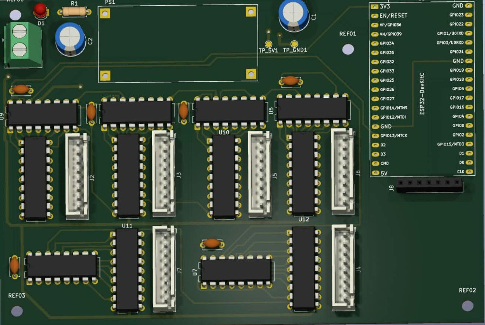
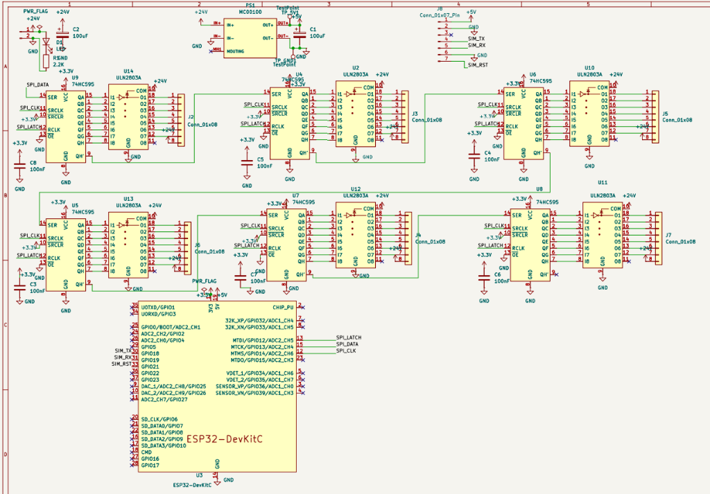
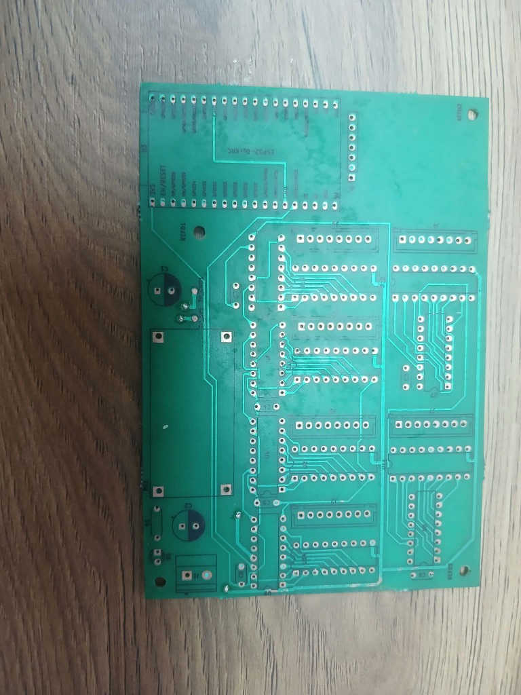
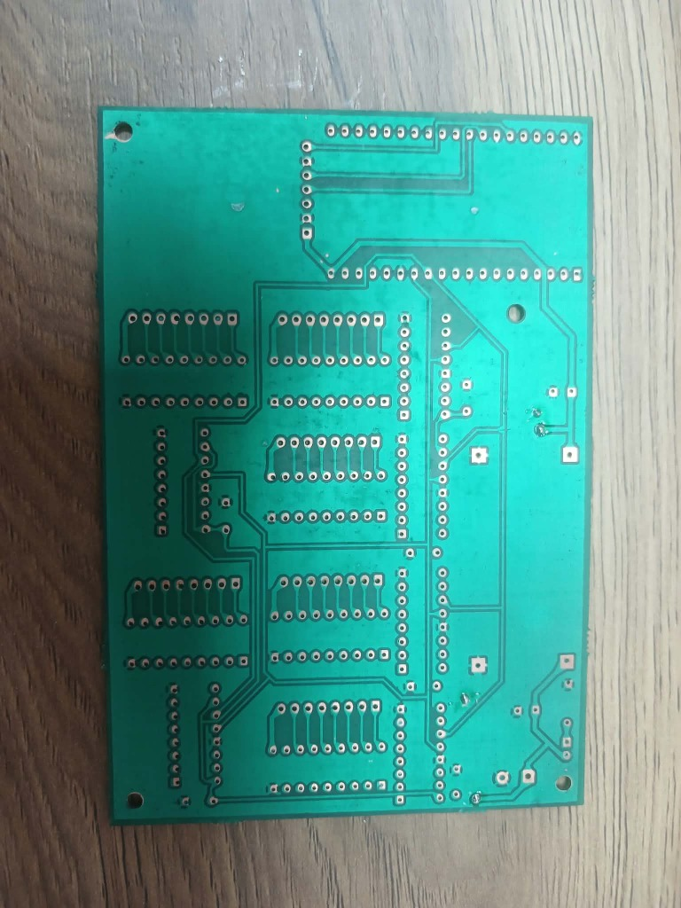

# ⏱️ ESP32 Giant 24V COB LED Chronometer & Industrial PCB

[](https://opensource.org/licenses/MIT)
[](https://www.espressif.com/)
[](https://www.arduino.cc/)
[](https://www.kicad.org/)
[-orange.svg)]()
[]()

An end-to-end industrial-grade embedded system featuring a **6-digit giant 7-segment display** driven by high-lumen **24V COB LED strips**, a custom modular **KiCad 10 PCB**, an **ESP32-WROVER-E** dual-core controller hosting an asynchronous real-time Web dashboard, and **SIM800L GSM cellular telemetry**.

Designed, developed, and fabricated by **[Bacem AMEUR](https://github.com/becem0)** (National Engineering School of Monastir - ENIM) during an engineering internship at **Chrono Sports Events**.

---

## 📸 Hardware Showcase & Gallery

<p align="center">
  <br>
  <em>Figure 1: Photorealistic 3D CAD render of the assembled CHRONO_01 board in KiCad 10.</em>
</p>

<p align="center">
  <br>
  <em>Figure 2: Complete electrical schematic (ESP32, 74HC595 cascade, ULN2803A drivers, LM2596 power regulation).</em>
</p>

<p align="center">
  
  <br>
  <em>Figure 3: Double-sided physical PCB fabricated via chemical etching (Left: Component side F.Cu, Right: Solder side B.Cu).</em>
</p>

---

## 📑 Table of Contents
- [Hardware Showcase & Gallery](#-hardware-showcase--gallery)
- [Key Features](#-key-features)
- [System Architecture](#-system-architecture)
- [Hardware & Electrical Engineering](#-hardware--electrical-engineering)
- [Firmware & Dual-Core Architecture](#-firmware--dual-core-architecture)
- [Web Dashboard UI](#-web-dashboard-ui)
- [Repository Structure](#-repository-structure)
- [Bill of Materials (BOM) & Economic Study](#-bill-of-materials-bom--economic-study)
- [Installation & Getting Started](#-installation--getting-started)
- [Author & License](#-author--license)

---

## 🌟 Key Features

* **High-Visibility Giant Display:** 6 digits (`HH:MM:SS`) using high-density 24V COB LED strips for uniform, neon-like illumination without individual LED hotspots.
* **Dual-Core Asynchronous Firmware:**
  * **Core 0:** Manages Wi-Fi Soft-AP (`SSID: CHRONO_01`) and serves an asynchronous HTML5/CSS3/JavaScript dark-mode web application via `ESPAsyncWebServer`.
  * **Core 1:** Executes deterministic $1\,\text{ms}$ chronometer counting, high-speed SPI shift register cascading, and non-blocking UART GSM AT parsing.
* **High-Power Common-Anode Driving:** 6 daisy-chained `74HC595` serial shift registers interfaced with 6 `ULN2803A` Darlington sink arrays, controlling 42 independent 24V segments at up to $500\,\text{mA}$ per channel.
* **GSM/SMS Telemetry:** Integrated `SIM800L` cellular transceiver with a customized $1000\,\mu\text{F}$ low-ESR reservoir network to absorb 2.0A TDMA RF burst current drops.
* **Cost Efficiency:** Sourced and built for approximately **740 TND (~€220)**, delivering performance comparable to turnkey commercial race scoreboards costing **3,000 to 20,000 TND**.


---

## 🏛 System Architecture

```text
 ┌─────────────────────────────────────────────────────────────────────────────┐
 │                               MAIN POWER SUPPLY                             │
 │                        (230V AC  ──>  24V DC / 2.5A SMPS)                   │
 └──────────────────────┬────────────────────────────────┬─────────────────────┘
                        │ (+24V Power Bus)               │ (+24V Input)
                        ▼                                ▼
       ┌─────────────────────────────────┐      ┌──────────────────────────────┐
       │   42x 24V COB LED SEGMENTS      │      │   LM2596 BUCK REGULATOR      │
       │   (6 Digits: A, B, C, D, E, F, G│      │   (24V DC  ──>  5.0V / 4.1V) │
       │    Common Anode Configuration)  │      └──────────────┬───────────────┘
       └────────────────▲────────────────┘                     │
                        │ Sinking Grounds (x42)                │
       ┌────────────────┴────────────────┐                     ▼
       │     6x ULN2803A DARLINGTON      │             ┌───────────────┐
       │        TRANSISTOR ARRAYS        │◄── 5V ──────┤  ESP32-WROVER │
       └────────────────▲────────────────┘             │   DUAL-CORE   │
                        │ 8-bit Parallel Out (x6)      │  (Soft-AP Web │
       ┌────────────────┴────────────────┐             │   Server +    │
       │       6x 74HC595 SERIAL         │◄── SPI ─────┤   FreeRTOS)   │
       │        SHIFT REGISTERS          │ (DATA/CLK/  └───────┬───────┘
       └─────────────────────────────────┘   LATCH)            │ UART (TX2/RX2)
                                                               ▼
                                                       ┌───────────────┐
                                                       │ SIM800L GSM   │
                                                       │ (+1000uF Cap) │
                                                       └───────────────┘
```

---

## ⚡ Hardware & Electrical Engineering

### I/O Expansion & Power Driving
Driving 42 discrete LED segments using only 3 GPIO pins from the ESP32:
* **`74HC595` Shift Registers:** Cascaded in series. The serial frame ($6 \times 8 = 48\,\text{bits}$) is clocked via high-speed SPI in less than $5\,\mu\text{s}$.
* **`ULN2803A` Darlington Sink Drivers:** 8 open-collector channels with integrated clamp diodes per IC. Each output can sink up to $500\,\text{mA}$ under $24\,\text{V}$, perfectly matching the common-anode COB LED segments.

```text
 ESP32 GPIO ────> 74HC595 (Qn) ───[2.7kΩ]───> ULN2803A (Base) ───> Sinks (-24V) to GND
                                                                           ▲
                                                  +24V Rail ───[LED Strip]─┘
```

### Mathematical Sizing & Transient Filtering
The GSM module consumes up to $I_{\text{peak}} = 2.0\,\text{A}$ in $577\,\mu\text{s}$ bursts. Without adequate capacitive reservoir sizing, the voltage droops below $3.7\,\text{V}$, causing brownout resets.

The required charge buffer is sized according to:
$$C_1 = \frac{I_{\text{peak}} \cdot \Delta t}{\Delta V_{\text{max}}} = \frac{2.0\,\text{A} \times 577\,\mu\text{s}}{0.4\,\text{V}} \approx 2885\,\mu\text{F}$$

Accounting for active source replenishment from the LM2596 buck converter, an effective capacitor of **$1000\,\mu\text{F}$ / 16V low-ESR** in parallel with a **$100\,\text{nF}$ ceramic decoupling capacitor** is placed directly at the SIM800L power pins.

### Single-Sided / NPTH PCB Optimization
To support artisan local PCB chemical etching without plated through-holes (NPTH):
* **Modular T-Shape Topology:** Eliminates track congestion and prevents layer crossing.
* **Machined-Pin Tulip Sockets:** DIP sockets are elevated above the PCB top copper layer to allow top-side manual soldering with fine iron tips.
* **Merged Drill Files:** Excellon drill files configured with "Merge PTH and NPTH" for single-pass fabrication.

---

## 💻 Firmware & Dual-Core Architecture

The firmware is written in Arduino C++ utilizing ESP32 FreeRTOS multitasking:

| Task | Core Assigned | Priority | Execution Interval | Role |
|---|---|---|---|---|
| **`WebNetworkTask`** | **Core 0** | Priority 1 | Asynchronous | Handles Wi-Fi Soft-AP client connections, REST endpoints (`/api/start`, `/api/pause`, `/api/reset`, `/api/set`), and serves HTML5 assets from SPIFFS/Flash. |
| **`ChronometerEngine`** | **Core 1** | Priority 3 | $1.00\,\text{ms}$ deterministic | Hardware timer tick accumulation, 7-segment digit lookup encoding, SPI shifting, and non-blocking SIM800L AT command parsing. |

---

## 📱 Web Dashboard UI

The responsive dark-theme dashboard runs entirely embedded within the ESP32 SPIFFS memory:
* **Zero Internet Required:** Automatically hosts a local hotspot `CHRONO_01` (192.168.4.1).
* **Live Synchronized Display:** CSS seven-segment digital display mirroring the real physical board.
* **Controls:** Start, Pause, Lap Time, Split Time, Time Preset, and Display Brightness.

---

## 📂 Repository Structure

```text
├── .gitignore
├── LICENSE
├── README.md
├── firmware/
│   ├── ChronoServer/
│   │   ├── ChronoServer.ino         # Main dual-core ESP32 firmware
│   │   └── index.html               # Embedded HTML5/CSS3/JS dashboard
│   └── tests/
│       ├── test_blink_esp32.ino     # GPIO & RTC validation test
│       └── test_sim800l_at.ino      # Hardware UART GSM pass-through test
├── hardware/
│   ├── kicad/                       # KiCad 10 schematics (.kicad_sch) and PCB (.kicad_pcb)
│   ├── gerbers/                     # Production Gerber and Excellon drill files
│   ├── schematics/
│   │   └── pinout_reference.md      # Pinout table for JST & shift registers
│   ├── bom/
│   │   └── bill_of_materials.md     # Detailed BOM and supplier breakdown
│   └── mechanical/
│       └── chassis_assembly.md      # Chassis drilling, baffles, and wiring guide
└── docs/
    ├── Journal stage 2026.pdf       # 30-day chronological internship journal
    ├── rapport_stage_2026.pdf       # Compiled official internship engineering report
    ├── stage_chrono_presentation.pdf # Oral defense slide deck
    └── report/
        ├── rapport_stage_bacem_ameur.tex # LaTeX source code
        └── figures/                 # High-resolution schematics, 3D renders & photos
```

---

## 💰 Bill of Materials (BOM) & Economic Study

| Category | Key Items | Cost (TND) | Approx. (€) |
|---|---|---|---|
| **Processing & Telemetry** | ESP32-WROVER-E + SIM800L GSM + LM2596 Buck | ~90 TND | ~€26 |
| **Power Drivers & Logic** | 6x 74HC595 + 6x ULN2803A + Tulip DIP sockets | ~60 TND | ~€18 |
| **Display & Illumination** | 24V COB LED Strips (10m) + JST-XH harnesses | ~100 TND | ~€29 |
| **Power Supply** | S-60-24 SMPS (230V AC $\to$ 24V DC / 2.5A) | ~55 TND | ~€16 |
| **Structure & Enclosure** | Forex (PVC) backplate + Opal PMMA acrylic diffuser | ~80 TND | ~€24 |
| **PCB & Consumables** | Chemical double-sided etching (120 TND), solder, capacitors, wiring | ~355 TND | ~€105 |
| **TOTAL PROJECT INVESTMENT** | | **~740 TND** | **~€220** |
| **Commercial Equivalent Price** | Turnkey 6-digit wireless race chronometers | **3,000 – 20,000 TND** | **€900 – €6,000** |


---

## 🚀 Installation & Getting Started

### 1. Arduino IDE Setup
1. Install **Arduino IDE 2.x**.
2. Install the **ESP32 Board Package** (Recommended: stable version `2.0.17` via Boards Manager).
3. Board Configuration:
   * **Board:** `ESP32 Wrover Module` (or `ESP32 Dev Module`)
   * **Flash Mode:** `DIO` (or `QIO` depending on flash vendor)
   * **Flash Frequency:** `40MHz`
   * **PSRAM:** `Enabled`
   * **Partition Scheme:** `Default 4MB with spiffs`
4. Install required libraries:
   * `ESPAsyncWebServer` & `AsyncTCP`

### 2. Flashing the Firmware
1. Connect the ESP32 to your PC via a Micro-USB data cable.
2. Open `firmware/ChronoServer/ChronoServer.ino`.
3. Select your COM port and hit **Upload** (➔).

### 3. Connecting to the Web Dashboard
1. Power on the chronometer with 24V DC.
2. On your phone or laptop, connect to the Wi-Fi network:
   * **SSID:** `CHRONO_01`
   * **Password:** `12345678`
3. Open any web browser and navigate to:
   * **`http://192.168.4.1`**

---

## 👤 Author

**Bacem AMEUR**  
*Electrical Engineering Student — National Engineering School of Monastir (ENIM)*  
* 📍 Sfax / Monastir, Tunisia  
* 💼 LinkedIn: [linkedin.com/in/becem-ameur](https://linkedin.com/in/becem-ameur)  
* 🐙 GitHub: [@becem0](https://github.com/becem0)  
* ✉️ Email: [Becemameur15@gmail.com](mailto:Becemameur15@gmail.com)

---

## 📜 License
This project is open-source and licensed under the [MIT License](LICENSE).
